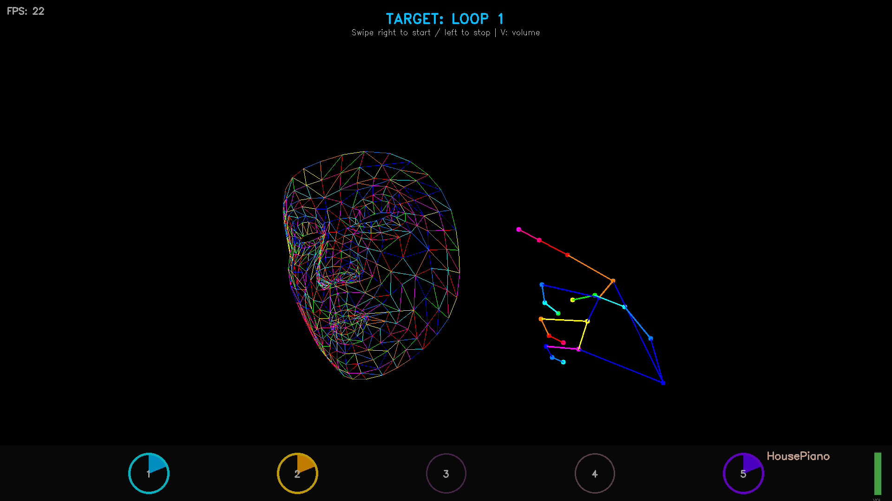

# Gesture Music Controller

A loop station played with one hand in front of a laptop webcam. Show 1–5
fingers to pick a loop, swipe right to start it and swipe left to stop it.
Loops start and stop on the boundary of the first loop, so they stay in
time. Built with MediaPipe, OpenCV and pygame.



## What it does

- **Loop selection by finger count.** Fingers are counted from joint angles
  and distances, so the palm or the back of the hand can face the camera.
  The count must hold for 0.12 s before it becomes the target.
- **Swipe to start or stop.** A swipe needs horizontal speed and travel,
  measured in image widths per second from frame timestamps. The target is
  fixed when the stroke reaches swipe speed.
- **Loops in time.** The first loop starts immediately and sets the master
  loop. Later starts and all stops wait for its next boundary. A left swipe
  on a waiting loop cancels its start; a right swipe on a stopping loop
  keeps it playing.
- **Wind-ups and returns.** A 0.8 s cooldown follows only swipes that
  change a loop, so a wind-up in the other direction does not block the
  swipe after it. A stroke that begins during the cooldown, such as the hand
  swinging back, never fires.
- **Fast flicks.** A quick flick often blurs the hand out of tracking for a
  few frames. If the hand reappears within 0.22 s further along the same
  direction, the swipe continues. Jumps faster than 4 image widths/s are
  treated as a different hand.
- **Volume** is locked by default. Press `v`, pinch thumb and index finger
  and hold to set it; press `v` again to lock.
- **Two views.** Reality shows the camera; Artistic draws the hand and face
  landmarks on black and flashes on a head nod.
- **Three sound sets** (HousePiano, BluesGuitar, FunkGuitar).
- **Measurement tools.** Record clips with frame timestamps, replay them
  headless through any commit, and score them
  ([docs/MEASUREMENT.md](docs/MEASUREMENT.md)).

## Tested

Measured on 2026-11-27 ([full results and conditions](docs/RESULTS-2026-11-27.md)):
one performer, one session, MacBook Pro (M4 Max) built-in camera at
1280×720, a pre-registered 14-gesture sequence. Four takes (normal light,
fast flicks, holding a drumstick, low light), 112 intended gestures, replayed
through three versions of the code:

| Condition | Before any change (`d600ad5`) | Before the fast-flick change (`cefbcd7`) | Current (`e4398d9`) |
|---|---|---|---|
| Normal light | 15.0% | 100% | 100% |
| Fast flicks | 23.3% | 73.3% | 100% |
| Holding a drumstick | 23.5% | 76.5% | 97.1% |
| Low light (screen only) | 10.7% | 35.7% | 89.3% |
| **All, 112 gestures** | **18.8%** | **69.6%** | **96.4%** |

Scripted hit rate: the intended swipe detected with the right direction and
finger count. Extra swipes, fired when nothing was intended, ran at 2.35 per
minute in replay with the current version, against 1.41 before the
fast-flick change. In the live takes none of them changed a loop.

Software latency, from reading the triggering camera frame to the `play()`
call, for a loop started from silence: median 8.2 ms (14 starts, live).
This leaves out camera capture and audio output.

**Not tested:** more than one performer or session; false triggers while
idle; end-to-end gesture-to-sound latency; the volume pinch and head nod;
other cameras, resolutions or rooms. The performer practised with the
current version, and some intended sequences are the performer's own
account (details in the results).

## Running it

Tested with Python 3.10.5, MediaPipe 0.10.21, OpenCV 4.11.0, pygame 2.6.1
on macOS.

```bash
git clone https://github.com/KIM-ocean-HZ/gesture-music-controller.git
cd gesture-music-controller
pip install -r requirements.txt

python main.py                      # camera 0, 1280×720, HousePiano
python main.py --demo               # no audio files needed
python main.py --camera 1 --width 1920 --height 1080
python main.py --sound-set FunkGuitar
python -m unittest discover tests   # 51 tests
```

**Audio files are not included.** The loops were made from Logic Pro's
sample content; which packs they came from was not recorded. Put 44.1 kHz
16-bit WAVs in `assets/`: `loop1–5.wav` (HousePiano), `guitar1–5.wav`
(BluesGuitar), `funk1–5.wav` (FunkGuitar), plus `startup.wav` and
`confirm.wav`. Missing files are logged and skipped.

| Gesture or key | Action |
|---|---|
| Show 1–5 fingers | Wait for `TARGET: LOOP N` |
| Swipe right | Start loop N (immediately from silence, otherwise at the next boundary) |
| Swipe left | Stop loop N at the next boundary |
| `v`, then pinch and hold | Set volume; `v` again locks it |
| `1` / `2` | Artistic / Reality view |
| `p` / `g` / `f` | HousePiano / BluesGuitar / FunkGuitar (stops current loops) |
| `s` / `h` / `q` | Screenshot / help / quit |

### Recording and measuring

```bash
python main.py --record recordings/take.mp4 --log recordings/take.jsonl
python bench/bench.py replay --label mylabel --manifest recordings/clips.csv
python bench/bench.py compare results/s1-baseline results/mylabel
python bench/bench.py latency recordings/take.jsonl
```

`--record-screen FILE` also saves the window as shown, and
`tools/render_video.py` adds a soundtrack mixed from the WAVs at the
logged start and stop times. Recordings show the performer and are kept out
of the repository.

## Project structure

```
main.py                 controller: camera, gestures, audio, rendering
demo_simple.py          hand tracking only, no audio
bench/bench.py          replay clips, score them, compare runs, latency
bench/diagnose.py       replay unlabelled clips for diagnosis
tools/render_video.py   demo video from a screen recording and its log
tests/                  finger-count fixtures, swipe, volume and bench tests
docs/MEASUREMENT.md     protocol and metric definitions
docs/RESULTS-2026-11-27.md
docs/REPAIR-R1.md       first repair record (in Chinese)
results/*/summary.json  per-clip numbers for each measured version
```

## Changelog

- **2026-11-27** — A swipe continues across a short loss of tracking, so
  quick flicks register. First full measurement: four conditions, three code
  versions ([results](docs/RESULTS-2026-11-27.md)). `--record-screen`, loop
  stops in the frame log, and a demo-video renderer.
- **2026-11-26** — The thumb counts only when it sticks out past the index
  knuckle; in a live check the performer reported 4 and 5 were no longer
  confused with the back of the hand to the camera. The loop target updates
  while the hand moves and is fixed at swipe speed. Cooldown only after
  swipes that change a loop; strokes begun during the cooldown never fire. A
  swipe can cancel a pending start or stop. A loop started from silence plays
  in the frame that triggered it. Replays use the real loop lengths and the
  clip's sound set (`--sound-set`).
- **2026-11-06** — First repair after a failed baseline attempt: finger
  counting from joint geometry, timestamped swipe detection, a settled loop
  target and a 0.22 s tracking grace period. Volume locked by default.
  ([record](docs/REPAIR-R1.md))
- **2026-11-05** — Restarted the project. Removed README claims with no code
  or measurement behind them. Added clip recording, headless replay,
  per-frame logs, a measurement script and tests. Pinned MediaPipe 0.10.21.
- **2026-04-10** — First public version.

## Author

**Hanze JIN** — BSc Computer Science, University of Nottingham
[GitHub: KIM-ocean-HZ](https://github.com/KIM-ocean-HZ)
